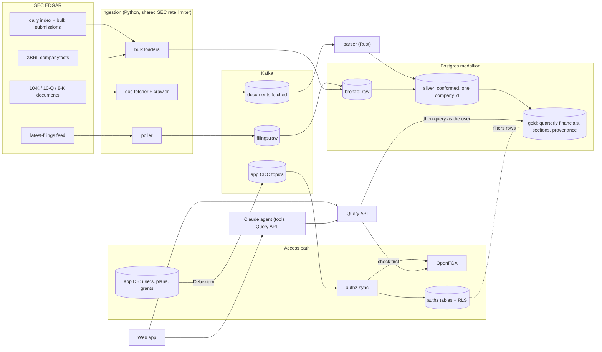

# Tributary

**A real-time SEC filings research platform where an AI analyst answers with citations, and only from the data you're allowed to see.**

**[Live demo → tributary.lucasgroves.dev](https://tributary.lucasgroves.dev)** · click *Try the demo* for your own
sandbox: every company's financials and filings, with a starter watchlist (PepsiCo, Coca-Cola,
Microsoft, Nvidia, Costco, JPMorgan) and workspace.
**[Data status](https://tributary.lucasgroves.dev/#/status)** (no sign-in): feed freshness, EDGAR-to-database
latency, completeness against EDGAR's daily indexes, coverage, data-quality checks and the last
recorded test-suite runs, live from the production database.

| | |
|---|---|
| **0 of 59** | permission attacks leaked data ([adversarial suite](tests/adversarial/report.md)) |
| **128 of 128** | figures in the agent's answers traced to a filing or XBRL fact ([citation suite](tests/citations/report.md)) |
| **< 0.2 s** | to revoke access everywhere after a grant changes: 0.11–0.17 s over 16 revocations in the recorded run ([report](tests/propagation/report.md)), up to 0.19 s in others; measured on every CI run, which fails above 3 s (BRD target: 30 s) |
| **43 s / 1.8 min** | p50 / p95 from EDGAR acceptance to Postgres during EDGAR business hours (5,312 filings, last 7 days; target 2 min). Overall p95 is 2.9 min: filings accepted after 5:30 pm ET mostly reach EDGAR's feed the next morning |
| **989,666** | SEC filers indexed; 6,024 operating companies with quarterly financials from XBRL |
| **265,625** | 10-K, 10-Q and 8-K filings from 5,342 companies over 5 years, crawled in 27 h at the SEC's 10 requests/s with 0 failures and parsed into 1.78M sections; 272 GB of HTML stored as 17.9 GB |
| **26M + 26M** | filing records and XBRL facts, kept current by nightly batch loads on one self-managed server |

## Architecture



Everything runs on one server ("hermes"): k3s, Helm charts deployed by Flux (GitOps) from this
repo, secrets encrypted with SOPS/age, Prometheus + Grafana + Loki with alerts, an outside
uptime check from GitHub Actions, nightly backups with a restore check, and a Cloudflare Tunnel
in front (Terraform-managed GitOps bootstrap and Cloudflare edge). GitHub Actions runs every test and builds the images; Flux deploys them.

## Design decisions

- **Two permission layers, not one.** The Query API asks OpenFGA before every query, then runs
  the query as a restricted Postgres role with the user's id set, so row-level security filters
  again. A bug in either layer alone can't leak data. SEC data is open to every signed-in user
  through a public catalog, but it goes through the same two layers: one row in the app database
  opens or closes it, and per-company grants and plan tiers still apply to anything outside it.
  Watching a company never grants access; that trap is in the adversarial suite.
- **Permissions are data, streamed.** Grants live in the app database; Debezium streams them to
  Kafka, and `authz-sync` is the only writer of OpenFGA tuples and RLS rows. It replays the
  compacted topics from the beginning and applies diffs, deletes first, so revocation is never
  lost or reordered.
- **The agent can't choose whose data it reads.** Its tools take no user parameter; it holds
  the asking user's token and calls the same Query API. Every figure in an answer is verified
  against what a tool returned before the answer reaches the user.
- **Medallion in SQL, provenance on every row.** Bronze keeps raw SEC payloads, silver resolves
  every CIK, ticker and former name to one company id, gold carries the filing, section or XBRL
  tag, ingested-at and freshness that the agent cites. Transforms are SQL functions, rebuildable
  from bronze.
- **One SEC rate limit across every pod.** A token bucket in Postgres (one locked row) keeps all
  services together under the SEC's 10 requests/s, with live traffic ahead of bulk crawls.
- **Rust where it pays.** The document parser was rewritten in Rust against a written spec and
  swapped in after producing identical sections to the Python reference on every test filing;
  it has parsed every filing since, including the 5-year crawl ([benchmarks](benchmarks)).
- **Batch, don't flood.** Bulk loads are capped batches with checkpoints and content hashes, so a
  re-run only touches what changed and a crash resumes where it stopped.

## Quickstart

Runs the whole stack locally with Docker Compose.


```bash
cp .env.example .env   # set SEC_USER_AGENT to your name/email
make hooks             # pre-commit secret scan (gitleaks)
make up                # Kafka, Postgres, OpenFGA
make migrate           # create/upgrade the tributary and app databases
make seed-app          # demo users (alice, bob, carol, dave) with plans and grants
make authz             # OpenFGA store + model (authz/model.fga)
make cdc               # Debezium: stream the app database's access tables into Kafka
make companies         # load company identity (FR5); then: SELECT * FROM silver.resolve_company('FB');
make financials        # XBRL financials for tracked companies → gold.quarterly_financials
make seed-documents    # load recent 10-K/10-Q/8-K history (fetched and parsed by up-all)
make exhibits          # 8-K press releases (EX-99.x) for 8-Ks already stored
make up-all            # + poller, bronze-loader, doc-fetcher, parser, authz-sync, query-api,
                       #   agent-api, and the chat UI on http://localhost:3000
make backfill DAYS=7   # fill in filings missing vs EDGAR's daily indexes
make psql              # query it: SELECT * FROM bronze.filings ORDER BY filed_at DESC LIMIT 10;
make consume           # watch filings arrive (or open the Kafka UI at http://localhost:8080)
```

## Access control

Every signed-in user (a demo sandbox, a GitHub account, the named test users) reads every
company's financials and filings, within their plan's tiers: the **public catalog** `catalog:sec`
holds every company with gold financials or a stored filing, and while it is public OpenFGA lets
every user read it (`catalog:sec#reader@user:*`) and row-level security accepts its companies
(`authz.public_access`). A request without a user reads nothing. Per-company grants (to a user
or an organization) still work for anything outside the catalog, and saved work (workspaces,
theses, models, reports, views) and a user's own market-data key and prices stay owner-only. The switch is one app-database row, streamed like any grant:

```sql
UPDATE public_catalogs SET public = true  WHERE catalog_id = 'sec';  -- open (db/app README)
UPDATE public_catalogs SET public = false WHERE catalog_id = 'sec';  -- close again
```

Change a grant, a plan or the switch in the app database and OpenFGA and the RLS tables follow
in under 0.2 s (0.11–0.17 s for revocations in CI, [report](tests/propagation/report.md);
`make propagation-test`, run in CI on every push, which fails above 3 s; target under 30 s):

```
app DB ─(Debezium CDC)─▶ Kafka ─▶ authz-sync ─┬─▶ OpenFGA (checked by the Query API)
                                              └─▶ authz.user_access, user_tiers, public_access
                                                  (row-level security)
```

### Query API

Every data request is checked twice: OpenFGA before any query, then Postgres row-level
security on the rows themselves (`services/query-api`). Running locally, the interactive API docs
are at `localhost:8000/docs`.

```bash
curl -H "Authorization: Bearer $(make -s token USER=alice)" \
  "localhost:8000/v1/companies/0001045810/financials?metrics=revenue"   # 200, cited
curl "localhost:8000/v1/companies/0001045810/financials?metrics=revenue" # 401: no user, no data
```

### Web app

`services/web` (React, TypeScript, Vite): a research workspace with Home (watchlist, new and
expected filings), a screener over every company, company tearsheets (statements, revenue,
segments, ratios, filings, peers), a chart builder with formula layers, comps tables, a filing reader
with "what changed" diffs, and full-text search. The assistant sits on every screen, sees what
you're looking at, and can build charts, screens and comps for you, with Undo. Model output is
sanitized and served under a strict Content-Security-Policy. `make web` runs the dev server on
:5173. Besides *Try the demo*, you can *Sign in with GitHub* (no scopes, public profile only) for
a permanent account that keeps your saved work.

#### Thesis and Model

Research ends in your own argument, so a workspace holds what you write next to what you chart:

- **Revenue view** (a company's Revenue tab): revenue by business segment, geography and
  product over time from the filings' XBRL (members missing a period shown as gaps, never zeros;
  bars stack only when the members add up to reported revenue), each segment's contribution to
  revenue growth in percentage points, and receivables against revenue (DSO, flagged when
  receivables grow more than 10 points faster than revenue). Each chart saves to a workspace so
  a thesis can embed it.
- **Model**: a revenue-first forecast for one company. Its fiscal-year revenue and operating
  income come live from the filings (as you, through the permission-checked API); you type
  growth and operating margin for each forecast year (1-10 years) with a note on why, each shown
  beside the company's own 5-year revenue CAGR and average margin. The chart draws history solid
  and your forecast dashed; the table labels every year Reported or Forecast. Only your
  assumptions are saved.
- **Thesis**: your Markdown about a company, with any chart, comps table, screen or model from
  the same workspace embedded where you put it, drawn live. Write, preview or both side by side;
  import a `.md` file and export one (embeds become `[Chart: name]` lines). Rendered through the
  same sanitizer as model output.
- **Check my thesis**: the agent reads your saved thesis as you, marks each factual claim
  Supported, Contradicted (with what the filing says) or Can't verify, each with citations that
  open the filing; compares each embedded model's growth and margin per year with the company's
  5-year history (computed in code, flagged when growth is more than 10 points off the CAGR or a
  margin is outside the 5-year range); and lists what the latest 10-K/10-Q says that you don't.
  Every figure goes through the same verifier as chat; anything it can't trace is flagged.
  Checks are kept with the thesis (history, stale once the text changes) and count as 4
  questions. The thesis reaches the model as escaped data, and its tools stay limited to the
  thesis's companies.
- **Revisit**: each check records the newest 10-K/10-Q in the SEC index for every company it
  covered, and the newest filing its citations rely on. When the company files a newer one, the
  thesis (and its workspace's list) says "New 10-Q filed <date> since your last check —
  re-check?"; after the re-check, "Changes since <date>" lists the claims whose verdict flipped
  (matched by quote), new and dropped claims, and model assumption flags that changed.

Both start from a company page or a workspace ("New thesis", "New model"), are owner-only in
both layers like all saved work (the Query API filters on the token's user; the app database's
row-level security is forced), and grant nothing: an embedded chart or a model's history is read
as the viewer, so it shows only what you may read.

#### Connect your data

Share prices can't be shown publicly (vendors license them for personal use, not
redistribution), so each user brings their own: in Settings → Connections you add your own
market-data API key (Tiingo first, behind a small adapter interface). Tributary validates it
with one call, stores it encrypted (AES-256-GCM envelope; the master key lives in the
deployment's secrets, never in the database; the ciphertext is bound to your user), and shows
you only the provider and its last four characters. End-of-day prices are fetched with your
key when you open a company, at most once a day, and stored for you alone: no cache is shared
between users. With a connection, a company's Price tab shows the daily close and a valuation
(market cap, P/E, P/S, EV/EBIT from your latest close and the latest filed figures, each with
its date), and the chart builder gets a price layer. Another user never sees your key or your
prices, in either permission layer (OpenFGA on the company, then owner-only row-level
security). Disconnecting deletes the key and every price fetched with it.

**Off until configured:** the feature exists only when the deployment has the
`data-connections-key` secret ([deploy/helm/tributary](deploy/helm/tributary/README.md#connect-your-data));
without it the routes are absent and the UI hides it. The assistant has no price tool yet.

### Agent

A Claude tool loop over the Query API (`services/agent`), served by `agent-api` as
server-sent events with per-user rate limits and a daily spend cap. Its tools take no user
parameter: the agent holds the asking user's token, so it sees exactly what that user may
read, and it cites the filing, section or XBRL tag, and freshness for every figure. Needs
`ANTHROPIC_API_KEY` in `.env`; the model is `AGENT_MODEL`. Tests use a scripted fake model.

```bash
make ask USER=alice Q="How has Nvidia's revenue changed over the last 4 quarters?"
make ask USER=alice Q="What are Nvidia's main risk factors?"
```

### Citation accuracy

Every answer is checked before it reaches the user (`services/agent/.../verify.py`): each
dollar figure must match a value a tool returned, be arithmetic on returned values, or appear
in returned filing text, and each accession number must have come from a tool. The chat shows
the result, and flags any figure it couldn't trace. On 32 questions across the demo users:
**32 of 32 answers fully verified, 128 of 128 figures traced** ([report](tests/citations/report.md)).
`make citations` runs it live; CI replays it.

### Adversarial suite

59 attacks (plan bypass, impersonation, fake system messages, watchlist tricks, indirect
leaks, tool-argument injection, ...) plus controls, run as the demo users against the live
stack with the catalog closed (per-company grants only): **0 leaks**
([report](tests/adversarial/report.md)). `make adversarial` runs it live; CI replays the
recordings. With the catalog open its targets move to what stays private (other users' saved
work, prompt injection in filings); see its [README](tests/adversarial/README.md).

## Layout

| Path | What |
|---|---|
| `services/` | One folder per deployable service or job (poller, bronze-loader, company-loader, facts-fetcher, doc-fetcher, parser, parser-rs, authz-sync, query-api, agent, web) |
| `libs/` | Shared Python packages (`sec`: SEC client with User-Agent and rate limiting; `authz`: OpenFGA client; `kafka`: Kafka client config from the environment, SASL/SCRAM included; `telemetry`: JSON logs and Prometheus metrics) |
| `db/` | Analytics migrations (`db/migrations`) and the app database (`db/app`) |
| `streaming/` | Debezium configs and Kafka topic docs |
| `authz/` | OpenFGA authorization model and its tests (`make authz-test`) |
| `tests/` | Adversarial, citation, integration, propagation, Kafka ACL and golden 10-K figure tests |
| `deploy/` | Helm charts (services, platform, monitoring), Flux, SOPS secrets, Terraform, host backup scripts |
| `benchmarks/` | Python vs Rust parser |

## License

Copyright © 2026 Lucas Groves. All rights reserved. The source is published to be read and
reviewed; it may not be copied, modified, deployed or reused without written permission (see
[LICENSE](LICENSE)). SEC data comes from EDGAR and is not covered by the notice.
