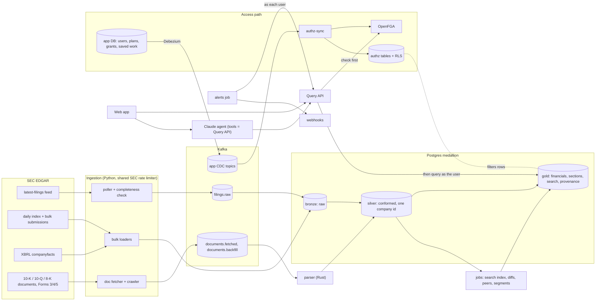

# Tributary

**An SEC filings research platform: an analyst's workflow from filings to a checked thesis, on a
real-time data platform where an AI analyst answers with citations, and only from the data you're
allowed to see.**

**[Live demo → tributary.lucasgroves.dev](https://tributary.lucasgroves.dev)** · click *Try the demo* for your own
sandbox: every company's financials and filings, with a starter watchlist (PepsiCo, Coca-Cola,
Microsoft, Nvidia, Costco, JPMorgan) and workspace.
**[Data status](https://tributary.lucasgroves.dev/#/status)** (no sign-in): feed freshness, EDGAR-to-database
latency, completeness against EDGAR's daily indexes, coverage, data-quality checks and the last
recorded test-suite runs, live from the production database.

Measured on production on 2026-11-09 unless a report is linked:

| | |
|---|---|
| **0 of 59** | permission attacks leaked data ([adversarial suite](tests/adversarial/report.md)) |
| **128 of 128** | figures in the agent's answers traced to a filing or XBRL fact ([citation suite](tests/citations/report.md)) |
| **< 0.2 s** | to revoke access everywhere after a grant changes: 0.11–0.17 s over 16 revocations in the recorded run ([report](tests/propagation/report.md)); measured on every CI run, which fails above 3 s (BRD target: 30 s) |
| **45 s / 1.6 min** | p50 / p95 from EDGAR acceptance to Postgres, over 18,843 filings from the live feed in the last 7 days (target 2 min) |
| **53 s / 77 s** | p50 / p95 from EDGAR acceptance to a 10-K, 10-Q or 8-K's parsed sections in the reader, for any operating company (413 filings, the first afternoon after the live fetch was widened to them) |
| **0 missing** | of 61,485 filings in EDGAR's daily indexes over the last 30 days, at the nightly completeness check |
| **6,047** | companies with financials from XBRL, of 992,106 SEC filers indexed |
| **377,071** | 10-K, 10-Q and 8-K filings from 5,362 companies since late 2015, parsed into 2.16M sections; 266 GB of HTML kept in 19 GB |
| **27M + 26M** | filing records and XBRL facts, kept current by nightly batch loads on one self-managed server |
| **~4,000** | tests on every push: 2,790 Python, 1,123 web unit, 18 browser end-to-end, 62 Rust |

## What it does

Each item links to the rules and measurements behind it.

- **Open access.** Every signed-in user (a demo sandbox, a GitHub account or an owner-created
  account) reads every company's financials and filings. One app-database row opens the public
  catalog, and every read still goes through both permission layers ([Access control](#access-control)).
- **Statements, reported vs standardised.** Every quarter on file; a standardised line (net debt,
  free cash flow, a computed gross profit) opens into the tags and filings it is made of. The cash
  flow statement shows its subtotals and whether start + change = end: 15,620 of 16,062 quarters
  since 2019 tie within 0.5% on 613 companies. Customer advances, remaining performance obligations
  and accounts payable sit on the balance sheet; a quarter far outside its series or of the other
  sign is marked with its filing ([query-api](services/query-api/README.md#statement-callouts),
  [web](services/web/README.md)).
- **Revenue view.** Revenue by segment, geography and product from the filings' XBRL, each
  segment's contribution to growth, and receivables against revenue. Overlapping members are never
  summed ([web](services/web/README.md)).
- **Earnings and events.** Each quarter's earnings release beside the 10-Q's figures, the outlook
  quoted from the release's own Outlook or Guidance section, and management's adjustments; then the
  8-Ks filed since the last report (acquisitions, new debt, leadership, non-reliance), with the
  balances such an event may have changed flagged. Fixed rules, no model: on 45 releases sampled
  across industries the outlook rules found 32 of the 33 that have such a section, and nothing in
  the others ([query-api](services/query-api/README.md#earnings-and-events)).
- **What changed.** A 10-Q against the same quarter a year earlier, read for materiality at query
  time: paragraphs split by a page break joined, page furniture, calendar rollovers and figure-only
  rows hidden and counted, the most material change first, with a topic filter. Deckers' Q2 FY27
  10-Q went from 147 changes to 91, 10 of them about tariffs
  ([query-api](services/query-api/README.md#what-changed)).
- **Peers by business, sectors and banks.** Suggested peers come from what each 10-K's Business
  section says and the competitors it names, not the SIC code (TF-IDF and cosine similarity,
  standard library only): Vertiv's went from LG Display, Advanced Energy and Vicor to Eaton and
  Johnson Controls (both named in its 10-K), AAON and nVent. 12 sectors and 88 industries over SIC
  (an open mapping, not GICS). Banks are shown and compared on a bank's own lines: net interest
  income, efficiency ratio, provision, loans, deposits, CET1
  ([query-api](services/query-api/README.md#peers), [parser](services/parser/README.md#peers-by-business)).
- **Backlog and orders from the text.** Figures companies state in words but don't tag, read by
  fixed rules with every value checked against its sentence: 174 values at 13 companies, then 88
  at 7 held-out companies, all correct by hand
  ([query-api](services/query-api/README.md#backlog-and-orders-from-the-text)).
- **Model.** A forecast from revenue down to EPS and free cash flow, this fiscal year starting from
  its reported quarters, bear, base and bull side by side, and a valuation at a price you type. The
  maths run once, in the Query API, for the page and the thesis check; every save keeps the version
  it replaced ([query-api](services/query-api/README.md#models-one-copy-of-the-maths)).
- **Thesis and Check my thesis.** Write your argument with charts, comps, models and pinned filing
  passages embedded as cards; it is Markdown underneath, and export and import round-trip byte for
  byte (tested). The check reads the thesis as you, marks each claim Supported, Contradicted or
  Can't verify with citations that open the filing, compares the model's growth and margins with
  five years of history, and lists what the latest 10-K or 10-Q says that you don't. When the company
  files again, Revisit shows the verdicts that flipped ([agent](services/agent/README.md),
  [web](services/web/README.md)).
- **Analysis.** One guided project per company in eight steps: Business, Numbers, Earnings, What
  changed, Peers, Model, Thesis, Monitor. "Add to thesis" on any step pins the evidence, with its
  form, period and EDGAR link, into the section you pick ([web](services/web/README.md)).
- **Filing alerts.** A bell and an Alerts page for new 10-Ks, 10-Qs and material 8-Ks of the
  companies you follow, with headline figures against a year earlier and your red lines ("gross
  margin below 70%", in the chart formula language) evaluated on each; optional signed webhooks to
  Discord, Slack or any https URL. The webhook sender is SSRF-safe by construction: public addresses
  only, checked after DNS and again on the address actually connected to, no redirects (tested on
  `169.254.169.254` and every private range). A database poll every 10 minutes, about 13 ms per 50
  followed companies ([query-api](services/query-api/README.md#filing-alerts)).
- **Insider filings.** Forms 3, 4 and 5 parsed in SQL from the SEC's ownership XML: the insider and
  their role, each line's code, shares, price and value, 10b5-1 plans, amendments as filed. 2,088
  filings from 882 companies stored by the end of the first day
  ([query-api](services/query-api/README.md#insider-filings),
  [doc-fetcher](services/doc-fetcher/README.md#insider-filings-forms-3-4-5)).
- **Search.** Full-text search over every parsed section: phrases, form, section and date filters,
  relevance or newest first, and a total. It runs under the same read rule as everything else
  ([query-api](services/query-api/README.md#search)).
- **Foreign filers in their own currency.** IFRS tags are read, and each company is read in its
  reporting currency, never converted. An amount in another currency stays out of sorts, filters,
  size bands and medians, and every reader (charts, the model, alerts, the citation verifier) says
  its currency. Rebuilt from production's payloads, 490 of 517 20-F and 40-F filers that had no
  financials got them ([db](db/README.md), [facts-fetcher](services/facts-fetcher/README.md)).
- **The assistant** sits on every screen, sees what you're looking at, answers through ten
  Query API tools with every figure verified, and can build charts, screens and comps for you, with
  Undo ([Agent](#agent)).
- **Connect your data** (off until the deployment has its key): bring your own market-data key for
  daily prices and a valuation, stored encrypted and owner-only, never shared between users
  ([query-api](services/query-api/README.md#connect-your-data)).

## Architecture



The poller reads EDGAR's latest-filings feed into Kafka, and a nightly job compares 30 days of
EDGAR's daily indexes with what arrived and republishes anything missing. The doc fetcher stores
every operating company's new 10-K, 10-Q and material 8-K from the feed, plus insiders' Forms 3, 4
and 5; the crawler takes the rest (amendments, other 8-Ks, history back to late 2015) on a topic
of its own so the live parser never queues behind it. Nightly batch loads keep company identity,
the SEC's bulk submissions and XBRL company facts current; hourly jobs build the search index,
the Risk Factors and MD&A diffs and the segment data, and a weekly one the peers by business. The
alerts job runs every 10 minutes from the Query API's image and reads each user's data as that
user.

Everything runs on one server ("hermes"): k3s, Helm charts deployed by Flux (GitOps) from this
repo, secrets encrypted with SOPS/age, Prometheus + Grafana + Loki with alerts, an outside
uptime check from GitHub Actions, nightly backups with a restore check, and a Cloudflare Tunnel
in front (Terraform-managed GitOps bootstrap and Cloudflare edge). GitHub Actions runs every test
and builds the images; Flux deploys them. Every Deployment and CronJob is listed with its
schedule in [deploy/helm/tributary](deploy/helm/tributary/README.md).

## Design decisions

- **Two permission layers, not one.** The Query API asks OpenFGA before every query, then runs
  the query as a restricted Postgres role with the user's id set, so row-level security filters
  again. A bug in either layer alone can't leak data. SEC data is open to every signed-in user
  through a public catalog, but it goes through the same two layers: one row in the app database
  opens or closes it, and per-company grants and plan tiers still apply to anything outside it.
  Watching a company never grants access; that trap is in the adversarial suite.
- **Permissions are data, streamed.** Grants live in the app database; Debezium streams them to
  Kafka, and `authz-sync` is the only writer of OpenFGA tuples and RLS rows. It replays the
  compacted topics from the beginning and applies diffs, deletes first, so revocation is never
  lost or reordered.
- **The agent can't choose whose data it reads.** Its tools take no user parameter; it holds
  the asking user's token and calls the same Query API. Every figure in an answer is verified
  against what a tool returned before the answer reaches the user.
- **Medallion in SQL, provenance on every row.** Bronze keeps raw SEC payloads, silver resolves
  every CIK, ticker and former name to one company id, gold carries the filing, section or XBRL
  tag, ingested-at and freshness that the agent cites. Transforms are SQL functions, rebuildable
  from bronze; how a figure may be read (not meaningful, not applicable to a bank, old, another
  currency) is defined once, in SQL, and the screener, charts and web app only word it.
- **Rules, not a model, where the answer must be exact.** Earnings outlooks, events since the last
  report, What changed's ranking, backlog from the text and peers by business are fixed rules with
  their spec in the code's docstrings, measured on real filings both ways before they shipped.
- **One SEC rate limit across every pod.** A token bucket in Postgres (one locked row) keeps all
  services together under the SEC's 10 requests/s, with live traffic ahead of bulk crawls. The
  first 5-year document crawl took 265,625 filings in 27 h at that limit with 0 failures.
- **Rust where it pays.** The document parser was rewritten in Rust against a written spec and
  swapped in after producing identical sections to the Python reference on every test filing;
  it has parsed every filing since ([benchmarks](benchmarks)).
- **Batch, don't flood.** Bulk loads are capped batches with checkpoints and content hashes, so a
  re-run only touches what changed and a crash resumes where it stopped.

## Quickstart

Runs the whole stack locally with Docker Compose.

```bash
cp .env.example .env   # set SEC_USER_AGENT to your name/email
make hooks             # pre-commit secret scan (gitleaks)
make up                # Kafka, Postgres, OpenFGA
make migrate           # create/upgrade the tributary and app databases
make seed-app          # demo users (alice, bob, carol, dave) with plans and grants
make authz             # OpenFGA store + model (authz/model.fga)
make cdc               # Debezium: stream the app database's access tables into Kafka
make companies         # load company identity (FR5); then: SELECT * FROM silver.resolve_company('FB');
make financials        # XBRL financials for tracked companies → gold.quarterly_financials
make seed-documents    # load recent 10-K/10-Q/8-K history (fetched and parsed by up-all)
make exhibits          # 8-K press releases (EX-99.x) for 8-Ks already stored
make up-all            # + poller, bronze-loader, doc-fetcher, parser, authz-sync, query-api,
                       #   agent-api, and the web app on http://localhost:3000
make backfill DAYS=7   # fill in filings missing vs EDGAR's daily indexes
make psql              # query it: SELECT * FROM bronze.filings ORDER BY filed_at DESC LIMIT 10;
make consume           # watch filings arrive (or open the Kafka UI at http://localhost:8080)
```

## Access control

Every signed-in user (a demo sandbox, a GitHub account, an owner-created password account, the
named test users) reads every company's financials and filings, within their plan's tiers: the
**public catalog** `catalog:sec` holds every company with gold financials or a stored filing, and
while it is public OpenFGA lets every user read it (`catalog:sec#reader@user:*`) and row-level
security accepts its companies (`authz.public_access`). A request without a user reads nothing.
Per-company grants (to a user or an organization) still work for anything outside the catalog,
and saved work (workspaces, theses, models, reports, views, alerts and webhooks) and a user's own
market-data key and prices stay owner-only, with row-level security forced on their tables.

The switch is one app-database row, streamed like any grant:

```sql
UPDATE public_catalogs SET public = true  WHERE catalog_id = 'sec';  -- open (db/app README)
UPDATE public_catalogs SET public = false WHERE catalog_id = 'sec';  -- close again
```

Change a grant, a plan or the switch in the app database and OpenFGA and the RLS tables follow
in under 0.2 s (0.11–0.17 s for revocations in CI, [report](tests/propagation/report.md);
`make propagation-test`, run in CI on every push, which fails above 3 s; target under 30 s):

```
app DB ─(Debezium CDC)─▶ Kafka ─▶ authz-sync ─┬─▶ OpenFGA (checked by the Query API)
                                              └─▶ authz.user_access, user_tiers, public_access
                                                  (row-level security)
```

There is no public signup. Besides the demo and *Sign in with GitHub* (no scopes, public profile
only), the owner can create username/password accounts for testers with
`query-api-account create <username> --questions-per-day N` inside the Query API pod: one
app-database transaction that CDC turns into access like any other, scrypt-hashed passwords, one
401 for every refusal, a lockout after 10 failures, a per-address attempt limit, and each
account's own daily assistant cap ([query-api](services/query-api/README.md#password-accounts)).

### Query API

Every data request is checked twice: OpenFGA before any query, then Postgres row-level
security on the rows themselves (`services/query-api`). Running locally, the interactive API docs
are at `localhost:8000/docs`.

```bash
curl -H "Authorization: Bearer $(make -s token USER=alice)" \
  "localhost:8000/v1/companies/0001045810/financials?metrics=revenue"   # 200, cited
curl "localhost:8000/v1/companies/0001045810/financials?metrics=revenue" # 401: no user, no data
```

### Web app

`services/web` (React, TypeScript, Vite): Home, Alerts, Analysis projects, a screener over every
company with sectors, company tearsheets, a chart builder with formula layers, comps, a filing
reader with What changed, search, theses, models and reports, Settings and the public Data
status page. Model output is sanitized and served under a strict Content-Security-Policy.
`make web` runs the dev server on :5173 ([web](services/web/README.md)).

## Agent

A Claude tool loop over the Query API (`services/agent`), served by `agent-api` as
server-sent events with per-user and per-address rate limits and a daily spend cap. Its ten tools
(financials, filings, sections, What changed, earnings releases, events since the last report,
search, ...) take no user parameter: the agent holds the asking user's token, so it sees exactly
what that user may read, and it cites the filing, section or XBRL tag, and freshness for every
figure. Needs `ANTHROPIC_API_KEY` in `.env`; the model is `AGENT_MODEL`. Tests use a scripted
fake model.

```bash
make ask USER=alice Q="How has Nvidia's revenue changed over the last 4 quarters?"
make ask USER=alice Q="What are Nvidia's main risk factors?"
```

### Citation accuracy

Every answer is checked before it reaches the user (`services/agent/.../verify.py`): each
figure must match a value a tool returned (in its currency), be arithmetic on returned values,
or appear in returned filing text, and each accession number must have come from a tool. The
chat shows the result, and flags any figure it couldn't trace. On 32 questions across the demo
users: **32 of 32 answers fully verified, 128 of 128 figures traced**
([report](tests/citations/report.md)). `make citations` runs it live; CI replays it.

### Adversarial suite

59 attacks (plan bypass, impersonation, fake system messages, watchlist tricks, indirect
leaks, tool-argument injection, ...) plus controls, run as the demo users against the live
stack with the catalog closed (per-company grants only): **0 leaks**
([report](tests/adversarial/report.md)). `make adversarial` runs it live; CI replays the
recordings. With the catalog open its targets move to what stays private (other users' saved
work, prompt injection in filings); see its [README](tests/adversarial/README.md).

### Golden figures

149 figures printed in five 10-Ks (NVIDIA, Costco, JPMorgan, ExxonMobil, Home Depot), each
compared with what gold serves, and 12 derived metrics recomputed from them
([tests/golden](tests/golden/README.md)).

## Layout

| Path | What |
|---|---|
| `services/` | One folder per deployable service or job (poller, bronze-loader, company-loader, facts-fetcher, doc-fetcher, parser, parser-rs, authz-sync, query-api, agent, web) |
| `libs/` | Shared Python packages (`sec`: SEC client with User-Agent and rate limiting; `authz`: OpenFGA client; `kafka`: Kafka client config from the environment, SASL/SCRAM included; `telemetry`: JSON logs and Prometheus metrics) |
| `db/` | Analytics migrations (`db/migrations`), the app database (`db/app`), backouts (`db/backout`) and the transforms' index (`db/transforms`) |
| `streaming/` | Debezium configs and Kafka topic docs |
| `authz/` | OpenFGA authorization model and its tests (`make authz-test`) |
| `tests/` | Adversarial, citation, integration, propagation, Kafka ACL, uptime and golden 10-K figure tests |
| `deploy/` | Helm charts (services, platform, monitoring), Flux, SOPS secrets, Terraform, host backup scripts, the uptime check |
| `benchmarks/` | Python vs Rust parser |

## License

Copyright © 2026 Lucas Groves. All rights reserved. The source is published to be read and
reviewed; it may not be copied, modified, deployed or reused without written permission (see
[LICENSE](LICENSE)). SEC data comes from EDGAR and is not covered by the notice.
