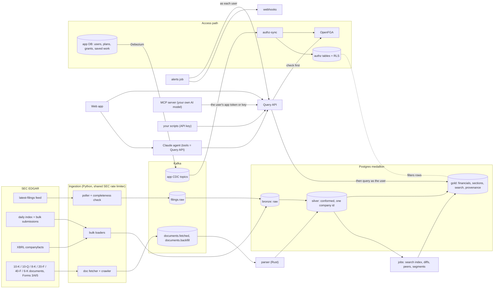

# Tributary

**An SEC filings research platform: an analyst's workflow from filings to a checked thesis, on a
real-time data platform where an AI analyst answers with citations, and only from the data you're
allowed to see.**

**[Live demo → tributary.lucasgroves.dev](https://tributary.lucasgroves.dev)** · click *Try the demo* for your own
sandbox: every company's financials and filings, with a starter watchlist (PepsiCo, Coca-Cola,
Microsoft, Nvidia, Costco, JPMorgan) and workspace.
**[Data status](https://tributary.lucasgroves.dev/#/status)** (no sign-in): feed freshness, EDGAR-to-database
latency, completeness against EDGAR's daily indexes, coverage, data-quality checks and the last
recorded test-suite runs, live from the production database.

Measured on production on 2026-11-17 unless the row or its report says otherwise (the status page has the live figures):

| | |
|---|---|
| **0 of 59** | prompt attacks on the assistant leaked data (recorded 2026-10-18 with the catalog closed, replayed in CI; [adversarial suite](tests/adversarial/report.md)). Cross-user tests of private data are being added |
| **128 of 128** | figures in the agent's answers traced to a filing or XBRL fact ([citation suite](tests/citations/report.md)) |
| **< 0.2 s** | to revoke access after a grant changes, measured in CI to OpenFGA and the RLS tables (0.11–0.17 s, [report](tests/propagation/report.md)), not yet on production; CI fails above 3 s (BRD target: 30 s) |
| **50 s / 8.8 min** | p50 / p95 from EDGAR acceptance to Postgres for the 85.6% of 22,084 filings (last 7 days) the live feed caught; the rest came from EDGAR's daily index hours later. Target 2 min at p95: missed |
| **53 s / 77 s** | p50 / p95 from EDGAR acceptance to a 10-K, 10-Q or 8-K's parsed sections in the reader (413 filings, measured 2026-11-09) |
| **2,820 of 77,428** | filings in EDGAR's daily indexes over the last 30 days were missing when the nightly completeness check ran (all on one day), and it republished them |
| **6,625** | companies with financials from XBRL, of 992,927 SEC filers indexed |
| **957** | figures printed in 96 companies' 10-Ks, checked against the database on every push, each difference listed; 808 of them machine-read and kept only where the print equals the filing's XBRL, not yet hand-checked ([reference set](tests/golden/README.md#reference-set)) |
| **6,068** | exchange-listed companies measured nightly for every kind of data gap, each one said on the company's page: fixable, not in the SEC's data, or out of scope ([db](db/DESIGN.md#076_coveragesql)) |
| **638,870** | 10-K, 10-Q and 8-K filings from 5,408 companies since November 2015, parsed into 3.59M sections; 433 GB of HTML kept in 28 GB |
| **27M + 33M** | filing records and XBRL facts, kept current by nightly batch loads on one self-managed server |
| **~4,000** | tests on every push: 3,000+ Python, 1,100+ web unit, 23 browser end-to-end flows, ~70 Rust |

## What it does

Each item links to where it is built; [DESIGN.md](DESIGN.md#what-it-does-in-detail) has each one
with its measurements.

- **Open access.** Every signed-in user (a demo sandbox, a GitHub account or an owner-created
  account) reads every company's financials and filings, through two permission layers.
- **Statements, reported vs standardised.** Every quarter on file; a standardised line opens into
  the tags and filings it is made of; outliers and sign flips are marked with their filing
  ([query-api](services/query-api/README.md#statement-callouts)).
- **As of any past day.** Every figure as it stood at the end of a chosen day, from the filings filed
  by then, each citing the filing that first stated it; restated figures marked with what they were
  first, and why they changed (a split, another line, the company's restatement). Gold keeps a
  history of itself, built by its own pipeline ([db](db/DESIGN.md#086_financials_knownsql),
  [query-api](services/query-api/README.md#point-in-time)). A day here is the filing date: a filing
  accepted after the market close (up to 17:30 New York) counts as known that day, and the company
  list and sectors are today's; both are on the list to fix before this backs a trading backtest.
- **Bring your own data.** Upload a CSV of your own figures by company and date (checked before
  anything is stored, companies matched exactly by ticker or CIK, each row known from its
  publication date or the upload day); formulas, charts and the company page read it beside
  Tributary's figures as `mine.<dataset>.<field>`, and saved formulas become screener columns.
  Owner-only under forced row-level security, never shared or mixed into Tributary's figures
  ([query-api](services/query-api/README.md#your-data)).
- **Revenue and segments** by business, geography and product, overlapping members never summed
  ([web](services/web/README.md)).
- **Earnings and events.** Each release beside the 10-Q, the outlook quoted from the release, its
  tables kept as tables, and the 8-Ks filed since the last report
  ([query-api](services/query-api/README.md#earnings-and-events)).
- **What changed.** A 10-Q against a year earlier, read for materiality: noise hidden and counted,
  the most material change first ([query-api](services/query-api/README.md#what-changed)).
- **Peers by business, sectors and banks.** Peers from what each 10-K's Business section says and
  the competitors it names; an open sector grouping over SIC; banks on their own lines
  ([query-api](services/query-api/README.md#peers), [parser](services/parser/README.md#peers-by-business)).
- **Backlog and orders from the text**, read by fixed rules and checked against their sentence
  ([query-api](services/query-api/README.md#backlog-and-orders-from-the-text)).
- **Model.** Revenue down to EPS and free cash flow, bear, base and bull, a valuation at your
  price; one copy of the maths, in the Query API
  ([query-api](services/query-api/README.md#models-one-copy-of-the-maths)).
- **Thesis and Check my thesis.** A Markdown thesis with charts, comps, models and pinned passages;
  the check marks each claim Supported, Contradicted or Can't verify, with citations
  ([agent](services/agent/README.md)).
- **Analysis.** One guided project per company in eight steps, from Business to Monitor
  ([web](services/web/README.md)).
- **Filing reader and search.** Sections with their tables kept as tables and page furniture left
  out; full-text search with phrases and filters, under the same read rule
  ([parser](services/parser/README.md), [query-api](services/query-api/README.md#search)).
- **Filing alerts** for followed companies, with red lines and SSRF-safe signed webhooks
  ([query-api](services/query-api/README.md#filing-alerts)).
- **Saved screens that alert.** Watch a saved screen and hear, after the night's figures, which
  companies entered or left it or crossed a line you set; checked as you (only companies you can
  read), with the screener's readings, the first check silent and each alert capped
  ([query-api](services/query-api/README.md#saved-screens-that-alert)).
- **Portfolio and decision journal.** Holdings from a Fidelity export (account numbers dropped as the
  file is read) or typed in, valued only on your own prices, each beside the thesis behind it; a
  journal kept as written after 24 hours, and a review due when a holding files its next 10-K or 10-Q.
  Owner-only: API keys, MCP and the assistant can't read it
  ([query-api](services/query-api/README.md#portfolio)).
- **Honest about each company's data.** A confidence mark (high, medium or low, with its reasons),
  each 10-K's and 10-Q's printed statement checked against the figures, a coverage note where the
  SEC's data has a gap, and histories carried across re-registrations (Broadcom from 2010 through
  Avago, Marvell from 2008) ([db](db/DESIGN.md#074_statement_reconciliation_confidencesql),
  [coverage](db/DESIGN.md#076_coveragesql)).
- **Insider filings.** Forms 3, 4 and 5 parsed from the SEC's ownership XML (33,572 stored)
  ([query-api](services/query-api/README.md#insider-filings),
  [doc-fetcher](services/doc-fetcher/README.md#insider-filings-forms-3-4-5)).
- **Foreign filers** (20-F, 40-F): figures in their own currency, never converted, kept out of
  cross-company sorts, and current to the latest annual report where the SEC's companyfacts lags
  (read from the filing's own XBRL); the annual reports in the reader and search (a 20-F's items
  with its risk factors, a 40-F's exhibits), and 6-K results releases on the Earnings tab
  ([db](db/README.md), [parser](services/parser/README.md#foreign-filers-rules-12-and-13),
  [doc-fetcher](services/doc-fetcher/README.md)).
- **The assistant** on every screen, answering through Query API tools with every figure verified
  ([agent](services/agent/README.md)).
- **API keys.** Personal access tokens for your own scripts: read or read and write, rate-limited
  per key, revoked at once, the same two permission layers; a public "Using the API" page and a
  one-file Python client ([query-api](services/query-api/README.md#api-keys),
  [client](clients/python/README.md)).
- **In your spreadsheet.** An Excel add-in (`=TRIBUTARY.VALUE`, `.SERIES`, `.SOURCE`) and a Google
  Sheets script (`=TRIBUTARY`), with the same key: up to 200 figures a request, each with its filing,
  and the reason instead of a number where a figure is stale, n/m or in another currency
  ([web](services/web/README.md#spreadsheet-add-ins),
  [query-api](services/query-api/README.md#spreadsheets)).
- **Your own AI model, through MCP.** A remote MCP server at `/mcp` with 28 read-only tools that
  cite their sources and hold no database login. Add it in claude.ai or ChatGPT by its URL: the app
  sends you to Tributary to sign in and approve it (OAuth 2.1 with PKCE, client ID metadata
  documents or dynamic registration, tokens bound to `/mcp` and stored hashed), and Settings lists
  connected apps to disconnect; or use the same API key
  ([mcp-server](services/mcp-server/README.md),
  [query-api](services/query-api/README.md#connected-apps-oauth)).
- **Connect your data** (off until the deployment has its key): your own market-data key for prices
  and a valuation ([query-api](services/query-api/README.md#connect-your-data)).
- **The look ("Seal").** An annual report kept as a ledger: serif figures, red rubrics, and a wax
  seal on every figure taken from a filing ([design record](.interface-design/system.md),
  [web](services/web/README.md)).

## Architecture



The poller reads EDGAR's latest-filings feed into Kafka; a nightly check compares 30 days of
EDGAR's daily indexes with what arrived and republishes anything missing. The doc fetcher stores
every operating company's new 10-K, 10-Q and material 8-K, and insiders' Forms 3, 4 and 5; a
crawler takes the rest on its own topic. The Rust parser writes sections and tables; nightly loads
keep identity, submissions and XBRL facts current; hourly and weekly jobs build search, diffs,
segments and peers.

Everything runs on one server ("hermes"): k3s, Helm charts deployed by Flux from this repo, SOPS
secrets, Prometheus, Grafana and Loki, nightly backups with a restore check, and a Cloudflare Tunnel
in front (Terraform). GitHub Actions runs every test and builds the images
([deploy](deploy/README.md), [jobs](deploy/helm/tributary/README.md)).

## Design decisions

- **Two permission layers.** OpenFGA before every query, then Postgres row-level security as the
  user; a bug in one layer alone can't leak data.
- **Permissions are data, streamed.** Grants live in the app database; Debezium and `authz-sync`
  turn them into OpenFGA tuples and RLS rows, deletes first.
- **The agent can't choose whose data it reads.** Its tools take no user; it holds the asking
  user's token, and every figure is verified before the answer is shown.
- **Medallion in SQL, provenance on every row.** Transforms are SQL functions rebuildable from
  bronze; how a figure may be read is defined once, in SQL.
- **Stored data upgrades itself.** Every parsed document, search passage, gold company and quality
  check records the rule version that built it; after a deploy, hourly jobs bring history up to the
  new rule in the background, oldest first, never ahead of new filings.
- **Checks that find wrong numbers first.** Nightly checks flag a filing that tags one line two ways
  that can't both be right, a parsed section under an item its form doesn't have, and every
  screener extreme nothing explains; the status page groups findings by what they mean for a reader
  (errors, to double-check, kept out, coverage, information) per 1,000 figures
  ([db](db/DESIGN.md#072_data_trust_checkssql)).
- **Rules, not a model, where the answer must be exact**, each measured on real filings.
- **One SEC rate limit across every pod**: a token bucket in one Postgres row.
- **Rust where it pays.** The parser was rewritten in Rust against a written spec and swapped in
  after matching the Python reference on every test filing ([benchmarks](benchmarks)).
- **Batch, don't flood.** Capped batches with checkpoints and content hashes.

The full version: [DESIGN.md](DESIGN.md#design-decisions-in-full).

## Quickstart

Runs the whole stack locally with Docker Compose.

```bash
cp .env.example .env   # set SEC_USER_AGENT to your name/email
make hooks             # pre-commit secret scan (gitleaks)
make up                # Kafka, Postgres, OpenFGA
make migrate           # create/upgrade the tributary and app databases
make seed-app          # demo users (alice, bob, carol, dave) with plans and grants
make authz             # OpenFGA store + model (authz/model.fga)
make cdc               # Debezium: stream the app database's access tables into Kafka
make companies         # load company identity (FR5); then: SELECT * FROM silver.resolve_company('FB');
make financials        # XBRL financials for tracked companies → gold.quarterly_financials
make seed-documents    # load recent 10-K/10-Q/8-K history (fetched and parsed by up-all)
make exhibits          # 8-K press releases (EX-99.x) for 8-Ks already stored
make up-all            # + poller, bronze-loader, doc-fetcher, parser, authz-sync, query-api,
                       #   agent-api, mcp-server (:8002), and the web app on http://localhost:3000
make backfill DAYS=7   # fill in filings missing vs EDGAR's daily indexes
make psql              # query it: SELECT * FROM bronze.filings ORDER BY filed_at DESC LIMIT 10;
make consume           # watch filings arrive (or open the Kafka UI at http://localhost:8080)
```

## Access, the agent and the suites

Every request names its user (a JWT or an API key) and is checked twice; a request without a user
reads nothing. One app-database row opens the public catalog; per-company grants and plan tiers
still apply; saved work, keys and alerts stay owner-only. The agent (`services/agent`) is a Claude
tool loop over the Query API with no user parameter. Its suites run live with `make citations` and
`make adversarial` and are replayed in CI: 0 leaks in 59 attacks, 128 of 128 figures traced, and
957 figures from 96 companies' 10-Ks match or are listed as a known difference
([tests/golden](tests/golden/README.md)). Details:
[DESIGN.md](DESIGN.md#access-control-and-the-agent).

```bash
make ask USER=alice Q="How has Nvidia's revenue changed over the last 4 quarters?"
curl -H "Authorization: Bearer $TRIBUTARY_API_KEY" \
  "localhost:8000/v1/companies/0001045810/financials?metrics=revenue"   # a key from Settings
```

## Layout

| Path | What |
|---|---|
| `services/` | One folder per deployable service or job (poller, bronze-loader, company-loader, facts-fetcher, doc-fetcher, parser, parser-rs, authz-sync, query-api, agent, mcp-server, web) |
| `clients/` | Clients for Tributary's API (`python/tributary_client.py`: one file, the standard library only) |
| `libs/` | Shared Python packages (`sec`: SEC client with User-Agent and rate limiting; `authz`: OpenFGA client; `kafka`: Kafka client config from the environment, SASL/SCRAM included; `telemetry`: JSON logs and Prometheus metrics) |
| `db/` | Analytics migrations (`db/migrations`), the app database (`db/app`), backouts (`db/backout`) and the transforms' index (`db/transforms`) |
| `streaming/` | Debezium configs and Kafka topic docs |
| `authz/` | OpenFGA authorization model and its tests (`make authz-test`) |
| `tests/` | Adversarial, citation, integration, propagation, Kafka ACL, uptime and golden 10-K figure tests |
| `deploy/` | Helm charts (services, platform, monitoring), Flux, SOPS secrets, Terraform, host backup scripts, the uptime check |
| `benchmarks/` | Python vs Rust parser |

## License

Copyright © 2026 Lucas Groves. All rights reserved. The source is published to be read and
reviewed; it may not be copied, modified, deployed or reused without written permission (see
[LICENSE](LICENSE)). SEC data comes from EDGAR and is not covered by the notice.
