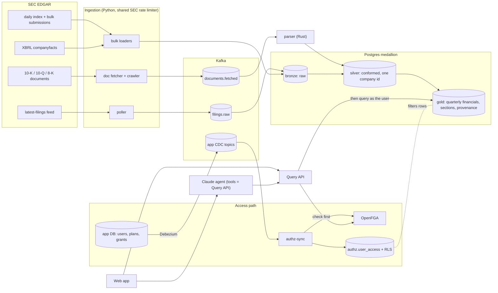

# Tributary

**A real-time SEC filings research platform where an AI analyst answers with citations, and only from the data you're allowed to see.**

**[Live demo → tributary.lucasgroves.dev](https://tributary.lucasgroves.dev)** · click *Try the demo* for your own
sandbox with 20 companies (PepsiCo, Coca-Cola, Apple, Microsoft, Nvidia, JPMorgan, ...).

| | |
|---|---|
| **0 of 59** | permission attacks leaked data ([adversarial suite](tests/adversarial/report.md)) |
| **128 of 128** | figures in the agent's answers traced to a filing or XBRL fact ([citation suite](tests/citations/report.md)) |
| **< 0.2 s** | to revoke access everywhere after a grant changes: 0.11–0.17 s over 16 revocations in the recorded run ([report](tests/propagation/report.md)), up to 0.19 s in others; measured on every CI run, which fails above 3 s (BRD target: 30 s) |
| **43 s / 1.8 min** | p50 / p95 from EDGAR acceptance to Postgres during EDGAR business hours (5,312 filings, last 7 days; target 2 min). Overall p95 is 2.9 min: filings accepted after 5:30 pm ET mostly reach EDGAR's feed the next morning |
| **989,666** | SEC filers indexed; 6,024 operating companies with quarterly financials from XBRL |
| **265,625** | 10-K, 10-Q and 8-K filings from 5,342 companies over 5 years, crawled in 27 h at the SEC's 10 requests/s with 0 failures and parsed into 1.78M sections; 272 GB of HTML stored as 17.9 GB |
| **26M + 26M** | filing records and XBRL facts, kept current by nightly batch loads on one self-managed server |

## Architecture



Everything runs on one server ("hermes"): k3s, Helm charts deployed by Flux (GitOps) from this
repo, secrets encrypted with SOPS/age, Prometheus + Grafana + Loki with alerts, an outside
uptime check from GitHub Actions, nightly backups with a restore check, and a Cloudflare Tunnel
in front (Terraform-managed GitOps bootstrap and Cloudflare edge). GitHub Actions runs every test and builds the images; Flux deploys them.

## Design decisions

- **Two permission layers, not one.** The Query API asks OpenFGA before every query, then runs
  the query as a restricted Postgres role with the user's id set, so row-level security filters
  again. A bug in either layer alone can't leak data. Watching a company never grants access;
  that trap is in the adversarial suite.
- **Permissions are data, streamed.** Grants live in the app database; Debezium streams them to
  Kafka, and `authz-sync` is the only writer of OpenFGA tuples and RLS rows. It replays the
  compacted topics from the beginning and applies diffs, deletes first, so revocation is never
  lost or reordered.
- **The agent can't choose whose data it reads.** Its tools take no user parameter; it holds
  the asking user's token and calls the same Query API. Every figure in an answer is verified
  against what a tool returned before the answer reaches the user.
- **Medallion in SQL, provenance on every row.** Bronze keeps raw SEC payloads, silver resolves
  every CIK, ticker and former name to one company id, gold carries the filing, section or XBRL
  tag, ingested-at and freshness that the agent cites. Transforms are SQL functions, rebuildable
  from bronze.
- **One SEC rate limit across every pod.** A token bucket in Postgres (one locked row) keeps all
  services together under the SEC's 10 requests/s, with live traffic ahead of bulk crawls.
- **Rust where it pays.** The document parser was rewritten in Rust against a written spec and
  swapped in after producing identical sections to the Python reference on every test filing;
  it has parsed every filing since, including the 5-year crawl ([benchmarks](benchmarks)).
- **Batch, don't flood.** Bulk loads are capped batches with checkpoints and content hashes, so a
  re-run only touches what changed and a crash resumes where it stopped.

## Quickstart

Runs the whole stack locally with Docker Compose.


```bash
cp .env.example .env   # set SEC_USER_AGENT to your name/email
make hooks             # pre-commit secret scan (gitleaks)
make up                # Kafka, Postgres, OpenFGA
make migrate           # create/upgrade the tributary and app databases
make seed-app          # demo users (alice, bob, carol, dave) with plans and grants
make authz             # OpenFGA store + model (authz/model.fga)
make cdc               # Debezium: stream the app database's access tables into Kafka
make companies         # load company identity (FR5); then: SELECT * FROM silver.resolve_company('FB');
make financials        # XBRL financials for tracked companies → gold.quarterly_financials
make seed-documents    # load recent 10-K/10-Q/8-K history (fetched and parsed by up-all)
make exhibits          # 8-K press releases (EX-99.x) for 8-Ks already stored
make up-all            # + poller, bronze-loader, doc-fetcher, parser, authz-sync, query-api,
                       #   agent-api, and the chat UI on http://localhost:3000
make backfill DAYS=7   # fill in filings the live poller missed (EDGAR daily indexes)
make psql              # query it: SELECT * FROM bronze.filings ORDER BY filed_at DESC LIMIT 10;
make consume           # watch filings arrive (or open the Kafka UI at http://localhost:8080)
```

## Access control

Revoke a grant in the app database and it's gone from OpenFGA and `authz.user_access` in
under 0.2 s (0.11–0.17 s in CI, [report](tests/propagation/report.md); `make propagation-test`,
run in CI on every push, which fails above 3 s; target under 30 s):

```
app DB ─(Debezium CDC)─▶ Kafka ─▶ authz-sync ─┬─▶ OpenFGA (checked by the Query API)
                                              └─▶ authz.user_access (row-level security)
```

### Query API

Every data request is checked twice: OpenFGA before any query, then Postgres row-level
security on the rows themselves (`services/query-api`). Running locally, the interactive API docs
are at `localhost:8000/docs`.

```bash
curl -H "Authorization: Bearer $(make -s token USER=alice)" \
  "localhost:8000/v1/companies/0001045810/financials?metrics=revenue"   # 200, cited
curl -H "Authorization: Bearer $(make -s token USER=alice)" \
  "localhost:8000/v1/companies/0001045810/sections/1A"                  # 403: Free plan
```

### Web app

`services/web` (React, TypeScript, Vite): a research workspace with Home (watchlist, new and
expected filings), a screener over every company, company tearsheets (statements, segments,
ratios, filings, peers), a chart builder with formula layers, comps tables, a filing reader
with "what changed" diffs, and full-text search. The assistant sits on every screen, sees what
you're looking at, and can build charts, screens and comps for you, with Undo. Model output is
sanitized and served under a strict Content-Security-Policy. `make web` runs the dev server on
:5173.

### Agent

A Claude tool loop over the Query API (`services/agent`), served by `agent-api` as
server-sent events with per-user rate limits and a daily spend cap. Its tools take no user
parameter: the agent holds the asking user's token, so it sees exactly what that user may
read, and it cites the filing, section or XBRL tag, and freshness for every figure. Needs
`ANTHROPIC_API_KEY` in `.env`; the model is `AGENT_MODEL`. Tests use a scripted fake model.

```bash
make ask USER=alice Q="How has Nvidia's revenue changed over the last 4 quarters?"
make ask USER=alice Q="What are Nvidia's main risk factors?"   # free plan: no filings access
```

### Citation accuracy

Every answer is checked before it reaches the user (`services/agent/.../verify.py`): each
dollar figure must match a value a tool returned, be arithmetic on returned values, or appear
in returned filing text, and each accession number must have come from a tool. The chat shows
the result, and flags any figure it couldn't trace. On 32 questions across the demo users:
**32 of 32 answers fully verified, 128 of 128 figures traced** ([report](tests/citations/report.md)).
`make citations` runs it live; CI replays it.

### Adversarial suite

59 attacks (plan bypass, impersonation, fake system messages, watchlist tricks, indirect
leaks, tool-argument injection, ...) plus controls, run as the demo users against the live
stack: **0 leaks** ([report](tests/adversarial/report.md)). `make adversarial` runs it live;
CI replays the recordings.

## Layout

| Path | What |
|---|---|
| `services/` | One folder per deployable service or job (poller, bronze-loader, company-loader, facts-fetcher, doc-fetcher, parser, parser-rs, authz-sync, query-api, agent, web) |
| `libs/` | Shared Python packages (`sec`: SEC client with User-Agent and rate limiting; `authz`: OpenFGA client; `kafka`: Kafka client config from the environment, SASL/SCRAM included; `telemetry`: JSON logs and Prometheus metrics) |
| `db/` | Analytics migrations (`db/migrations`) and the app database (`db/app`) |
| `streaming/` | Debezium configs and Kafka topic docs |
| `authz/` | OpenFGA authorization model and its tests (`make authz-test`) |
| `tests/` | Adversarial, citation, integration, propagation, Kafka ACL and golden 10-K figure tests |
| `deploy/` | Helm charts (services, platform, monitoring), Flux, SOPS secrets, Terraform, host backup scripts |
| `benchmarks/` | Python vs Rust parser |
